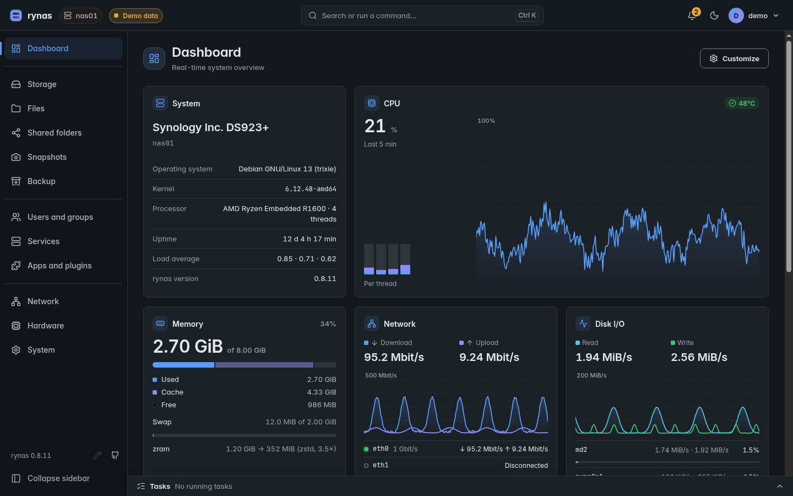
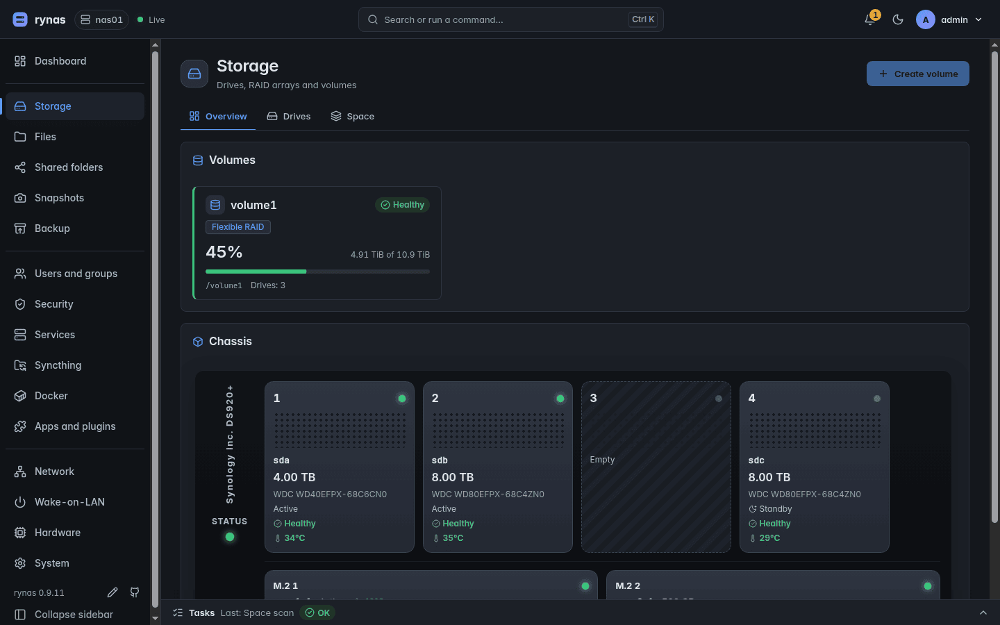
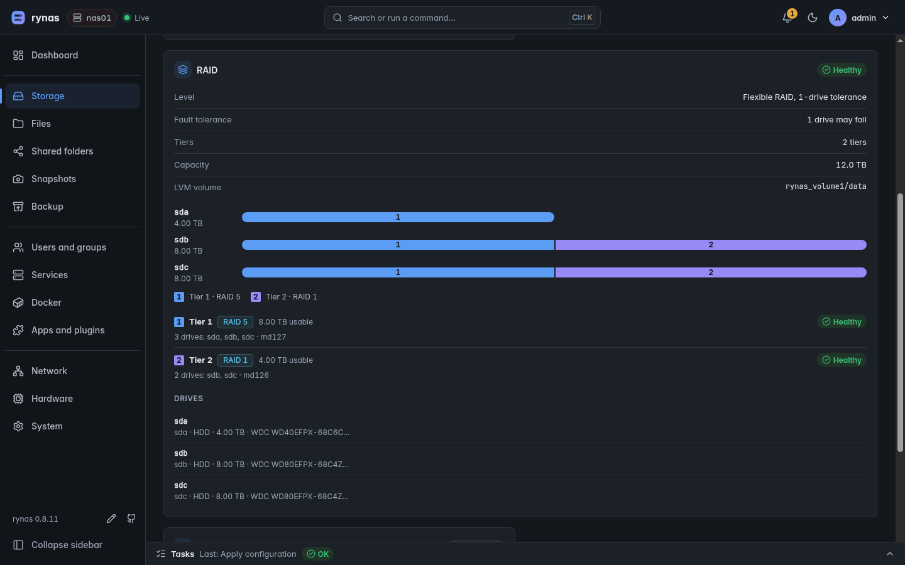
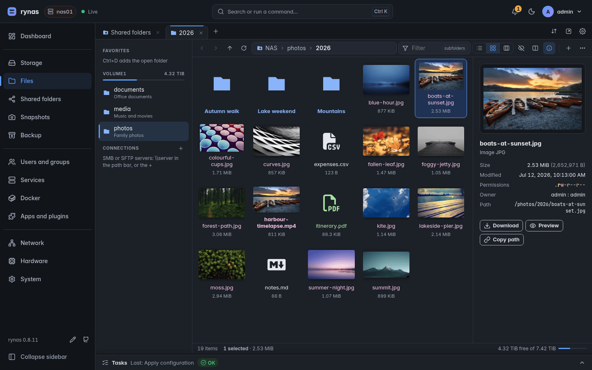
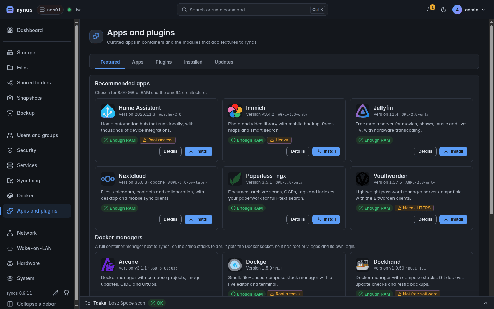
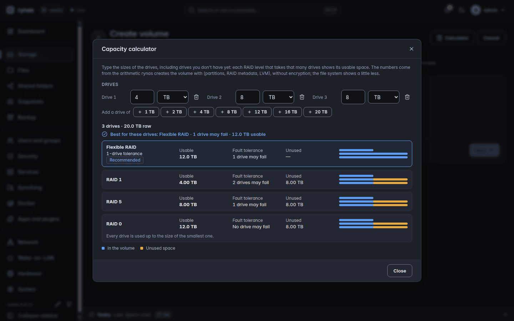

<h1 align="center">rynas</h1>

<h3 align="center">A complete NAS on plain Debian, in 33 MB of RAM.</h3>

<p align="center">
Flexible RAID, shares, snapshots, backups, Docker apps and HTTPS from one web interface.<br>
Written in Rust. Built for power users, usable by anyone.
</p>

<p align="center">
  <a href="https://github.com/rylos/rynas/releases/latest"></a>
  <a href="LICENSE"></a>
  
  
  
</p>

<p align="center">
  <a href="#install"><b>Install</b></a> ·
  <a href="#features"><b>Features</b></a> ·
  <a href="#synology-and-qnap-hardware"><b>Synology</b></a> ·
  <a href="docs/"><b>Docs</b></a>
</p>

<p align="center">
  
</p>

Install Debian your way, add one package, and the server becomes a NAS you run from the
browser. Underneath it is all plain Debian: mdadm, LVM, btrfs, Samba, NFS, systemd, Docker Compose.

> [!NOTE]
> **Beta.** Every main feature is in place and runs daily on real NAS hardware; expect rough
> edges until 1.0, and keep backups.

## Light, measured

| | |
|---|---|
| **Idle memory** | **~33 MB** for the whole manager: daemon 23 MB + web server 10 MB (resident) |
| **API answers** | **0.5 ms** for the full storage tree (median of 20 requests) |
| **Download** | one **33 MB** `.deb`; the whole interface loads as **~2 MB** of compressed WebAssembly |
| **Oldest box it runs on** | a 2014 dual-core Celeron J1800 with **2 GB of RAM**, daily, with room to spare |

<sub>Measured on rynas 0.9.11, idle: a DS920+ (Celeron J4125, 4 GB) running Debian 13 through
synodeb, and a QNAP HS-251 (Celeron J1800, 2 GB). Memory is resident set size (`ps`/`smaps_rollup`);
the optional HTTPS proxy, rynas-caddy, adds 26 MB. API time: `curl` on rynasd's Unix socket.</sub>

## Why rynas

- **A NAS layer, not an operating system.** Stock Debian, standard config files, `apt`
  updates. Remove rynas and you keep a working server with its shares, users and data.
- **It shows its work.** Every storage change is planned before it runs: each step with its
  real command (mdadm, sgdisk, LVM, cryptsetup, btrfs), the disks it will erase by model and
  serial, and how it resumes if the power fails halfway.
- **Every drive counts.** [Flexible RAID](#flexible-raid) uses the full size of mixed drives
  and grows one drive at a time, on plain md, LVM and btrfs.
- **Fast by construction.** Rust from the root daemon to the WebAssembly interface; pages
  update live, and <kbd>Ctrl</kbd> <kbd>K</kbd> reaches any page, setting or action.
- **Power without the cliff.** Guided flows in plain language for everyday tasks; the real
  arrays, subvolumes, units and logs one click away. Nothing dumbed down.
- **In your pocket.** The [Android app](https://github.com/rylos/rynas/releases/download/android/rynas-android.apk)
  browses and manages the shares, uploads and downloads in the background, shows the NAS in
  Android's file picker and keeps alerts and status on the home screen. Paired by QR code,
  certificate pinned, no Google services.
- **Yours.** No cloud account, no telemetry, every feature free. Apps come from a
  [signed catalogue](https://github.com/rylos/rynas-catalog); Linux PCs get bare-metal
  backups to the NAS.

## Flexible RAID

Classic RAID cuts every drive to the smallest: 4 + 8 + 8 TB in RAID 5 gives 8 TB. Flexible RAID
splits the drives into tiers, each an md array, joined by LVM into one btrfs volume (optionally
LUKS-encrypted): the same drives give **12 TB**, and any one can fail. Two-drive tolerance is
there too. Add a drive or swap one for a larger one and the new space is usable; a growth cut
short by a power failure continues where it stopped. Classic levels (0, 1, 5, 6, 10) stay available.

## Features

| | |
|---|---|
| **Storage** | mdadm arrays, btrfs/ext4 volumes, LUKS2, flexible RAID, chassis view, SMART, spin-down, zram |
| **Files** | a full web file manager: upload, preview, text editor, space analysis, SMB/SFTP connections |
| **Shares** | SMB (with Time Machine), NFS, per-user and per-group permissions, quotas, recycle bin |
| **Snapshots** | scheduled btrfs snapshots, file restore, rollback, system restore points, replication |
| **Backup** | encrypted, deduplicated (restic format) to a NAS, USB disk or cloud; bare-metal backups of Linux PCs |
| **Docker & apps** | compose stacks with an editor, image update checks, and 27 curated apps installed in a few clicks |
| **Web access** | HTTPS for the interface and every app: `.local` names, Let's Encrypt via DNS, LAN/VPN rules, Tailscale |
| **System** | users and groups, 2FA, network with safe rollback, apt repositories, scheduler, notifications, UPS |

<table>
  <tr>
    <td width="50%"><br><sub><b>Storage</b>: volumes and a live view of every bay</sub></td>
    <td width="50%"><br><sub><b>Flexible RAID</b>: 4 + 8 + 8 TB drives give 12 TB</sub></td>
  </tr>
  <tr>
    <td width="50%"><br><sub><b>Files</b>: a full file manager in the browser</sub></td>
    <td width="50%"><br><sub><b>Apps</b>: a signed catalogue, installed in a few clicks</sub></td>
  </tr>
  <tr>
    <td width="50%"><br><sub><b>Docker</b>: your stacks, whoever made them</sub></td>
    <td width="50%"><br><sub><b>Calculator</b>: every RAID level for any set of drives</sub></td>
  </tr>
</table>

<sub>Screenshots from a local test instance with simulated hardware and demo data.</sub>

## Install

Debian 13 (trixie), amd64. Each [release](https://github.com/rylos/rynas/releases/latest) has
the package, built by GitHub Actions, with its `SHA256SUMS`:

```sh
curl -fLO https://github.com/rylos/rynas/releases/latest/download/rynas_<version>-1_amd64.deb
sudo apt install ./rynas_<version>-1_amd64.deb
```

Then open `https://<your-server>.local/` (or `http://<your-server>:8080/`) and sign in with an
administrator account of the server. The PC backup agent ships in the same release.

## Synology and QNAP hardware

rynas runs on any Debian box. On Synology hardware, use
[**synodeb**](https://github.com/rylos/synodeb): it installs Debian 13 on the DS920+, DS923+
and DS423+ with fans, LEDs, buttons, beeper, power schedule, UPS and every bay working. rynas
detects it and adds the hardware screens (the real chassis, fan modes, LEDs, power schedule);
on other machines they stay hidden. The QNAP HS-251 has its own module: bays, fans, LEDs and
power recovery.

## More

[Installed layout and first sign-in](packaging/deb/README.Debian) ·
[Building and architecture](docs/building.md) · [Design documents](docs/) ·
[Contributing](CONTRIBUTING.md)

## License

rynas is **free software** under the [GNU AGPL v3.0 or later](LICENSE): free for everyone,
companies included, every feature included. The plugin interface (`rynas-api-types`) is
Apache-2.0, so plugins can use any license. An optional subscription may come one day; it will
never lock features ([details](docs/phase0/04-license.md)).

App icons come from [Dashboard Icons](https://github.com/homarr-labs/dashboard-icons)
(Apache-2.0); the logos belong to their owners ([`apps/ICONS.md`](apps/ICONS.md)).

<sub>rynas is an independent project, not affiliated with, endorsed by or supported by
Synology Inc. or QNAP Systems, Inc. Synology, DSM, QNAP and related names are trademarks of
their owners, used here only to describe hardware compatibility.</sub>

<p align="center"><sub>Made in Italy 🇮🇹</sub></p>
