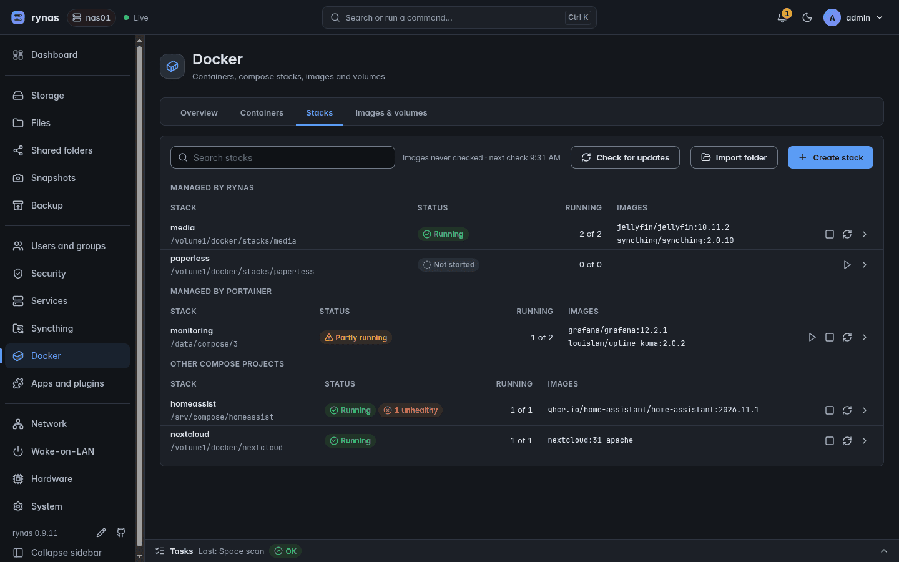
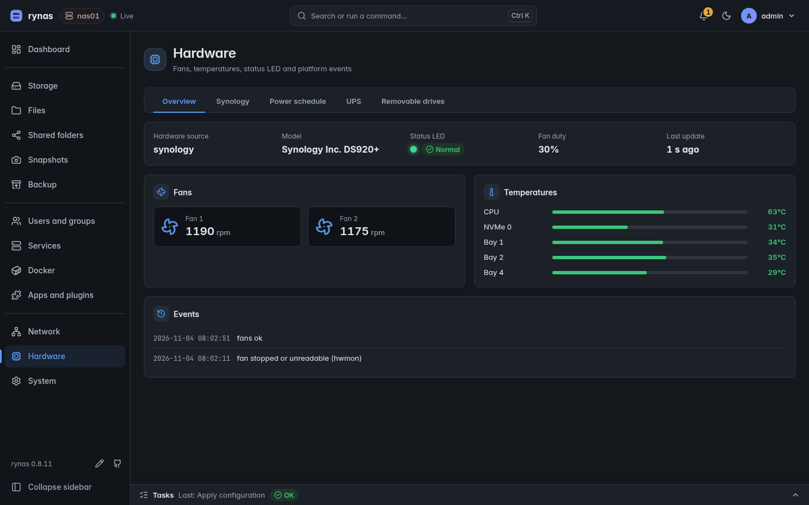

<h1 align="center">rynas</h1>

<h3 align="center">
A fast, modern NAS manager for plain Debian.<br>
Storage with flexible RAID, shares, snapshots, backups, Docker apps and HTTPS<br>
from one web interface, written in Rust.
</h3>

<p align="center">
  <a href="LICENSE"></a>
  
  
  
</p>

<p align="center">
  
</p>

You install Debian your way, then add one package: **rynas** turns the server into a NAS you
manage from the browser. Nothing is hidden: everything rynas does is plain Debian underneath
(mdadm, btrfs, Samba, NFS, systemd, Docker Compose, Caddy), so your data and your system stay
yours, with or without rynas.

> [!NOTE]
> rynas is **beta software**. The main features are in place and it runs every day on real NAS
> hardware, but there can still be rough edges and small changes before 1.0. Keep backups, as
> with any storage system, and report what you find.

## Who it is for

rynas is a professional tool for people who run their own servers: administrators, homelab
operators and small businesses who know what an md array, a LUKS header, a btrfs subvolume or a
systemd unit is, and want them driven well, not hidden. It is deliberately technical and
powerful. It is not made for beginners.

- **It shows its work.** Every storage change is planned before it runs: each step with its real
  command (mdadm, sgdisk, LVM, cryptsetup, btrfs), the disks it will erase by model and serial,
  and how it resumes if power fails halfway.
- **It exposes the real system**, not a simplified copy: arrays and their members, LVM volumes,
  subvolumes, mount options, systemd units, cgroups and logs, as they are on disk.
- **You stay in charge.** Guided flows never act behind your back. No cloud account, no
  telemetry, no "easy mode" that trades control for convenience.
- **It does not replace knowledge.** It makes replacing a disk, growing an array or restoring a
  backup faster and safer, not something you can do without understanding it.

## Why rynas

- **Fast on modest hardware.** A small privileged daemon, a Rust HTTP server and a WebAssembly
  interface: a few MB of RAM at rest, pages that update live.
- **Plain Debian underneath.** No custom distribution, no lock-in: standard tools, standard
  config files, standard `apt` updates. Remove rynas and the server keeps working.
- **Safe changes.** Changes are staged and applied together. Network changes roll back by
  themselves if you lose the connection; snapshots and restore points come before risky
  operations.
- **Apps that stay current.** A signed app catalogue, updated apart from rynas releases; image
  updates checked daily and applied automatically if you want, stack by stack.
- **Made for the keyboard.** <kbd>Ctrl</kbd> <kbd>K</kbd> finds any page, setting or action.
  Light and dark themes; English, Italian and Russian.
- **Free software, every feature included.** AGPL-3.0, free for everyone, companies included.

## Flexible RAID

Classic RAID cuts every drive to the size of the smallest: 4 + 8 + 8 TB in RAID 5 gives 8 TB
and leaves 8 TB unused. **Flexible RAID** uses all of it. The drives are split into tiers: each tier
takes the same slice of every drive large enough for it and is an md array (RAID 1 or 5, or a
three-way mirror and RAID 6 for two-drive tolerance); LVM joins the tiers into one btrfs volume,
optionally LUKS-encrypted. The same
three drives give **12 TB**, and any one of them can fail.

- **Grows one drive at a time.** Add a drive, or replace a drive with a larger one, and the new
  space becomes usable: no need to buy a whole set of matching drives.
- **Plain tools, resumable.** Every step is an ordinary mdadm, LVM or btrfs command, shown before
  it runs; a growth or a replace stopped by a power cut continues where it was.
- **Pick with numbers.** The capacity calculator in the volume wizard shows what any set of
  drives, even ones you don't have yet, gives at every level.

The classic levels (single, RAID 0, 1, 5, 6 and 10) stay available next to it.

## Features

| | |
|---|---|
| **Dashboard** | live CPU, memory, network, disk I/O and temperatures; customizable widgets |
| **Storage** | RAID arrays and volumes (mdadm, btrfs, ext4, LUKS2 encryption), [flexible RAID](#flexible-raid) for drives of different sizes, a capacity calculator, a drive view of the chassis, SMART, spin-down, zram |
| **Files** | a full web file manager: upload, preview, text editor, space analysis |
| **Shared folders and services** | SMB (with Time Machine), NFS, per-user and per-group permissions, quotas, recycle bin |
| **Snapshots** | scheduled btrfs snapshots with retention, file restore, rollback, system restore points, replication to another volume or NAS |
| **Backup** | encrypted, deduplicated backups (restic format) to another NAS, a USB disk or the cloud (SFTP, S3, B2, REST, rclone); **bare-metal backups of Linux PCs**: taken live from a btrfs or LVM snapshot while the PC runs, restorable to a new or empty disk from any live Linux (GPT partitions, LUKS, ext4/btrfs/XFS/vfat and GRUB or systemd-boot recreated; LVM and md layouts are still recreated by hand), single files from the web interface |
| **Docker** | engine setup, compose stacks with an editor, containers with CPU and memory, logs, daily image update checks with optional automatic updates; works next to Portainer, Dockge or Dockhand |
| **Apps** | a curated, signed catalogue (Immich, Jellyfin, Home Assistant, Nextcloud, Paperless-ngx, Vaultwarden, Frigate, JDownloader… 27 and growing) installed in a few clicks, kept current by automated, tested updates |
| **Web access** | HTTPS for the interface and every app through a built-in Caddy: `.local` names, Let's Encrypt certificates through your DNS provider, LAN or VPN access rules, Tailscale |
| **Users and security** | users, groups, PAM login, two-factor authentication (TOTP), fail2ban |
| **System** | network (bonding, VLANs) with safe apply, task scheduler, notifications (e-mail, ntfy, Gotify), updates, configuration restore |
| **Hardware** | fans, temperatures, status LEDs, UPS (NUT), power schedule, removable drives; dedicated modules for Synology (with synodeb) and QNAP hardware |

<table>
  <tr>
    <td></td>
    <td></td>
  </tr>
  <tr>
    <td align="center"><b>Storage</b>: volumes and a live view of every bay</td>
    <td align="center"><b>Apps</b>: a curated catalogue, installed in a few clicks</td>
  </tr>
  <tr>
    <td></td>
    <td></td>
  </tr>
  <tr>
    <td align="center"><b>Docker</b>: your stacks, including those made by other tools</td>
    <td align="center"><b>Hardware</b>: fans, temperatures, LEDs and UPS</td>
  </tr>
</table>

<sub>The dashboard screenshot uses demo data; the others come from a test instance.</sub>

## Got a Synology? Use it with synodeb

[**synodeb**](https://github.com/rylos/synodeb) installs **Debian 13 on Synology DS920+, DS923+ and
DS423+** with all the NAS hardware working: fans, LEDs, buttons, beeper, power schedule, UPS,
watchdog, every bay and both M.2 slots. DSM can stay on its own disks.

Put rynas on top and you get a modern NAS interface on Synology hardware. rynas detects synodeb
and adds its hardware screens: the real chassis with its bays, fan modes, LEDs and the power
schedule. On any other Debian server those screens simply stay hidden.

QNAP models get the same treatment through their own module, starting with the **HS-251**
(verified on the hardware): bays, fans, LEDs and power recovery.

## Install

rynas targets **Debian 13 (trixie), amd64**. There is no apt repository yet. Each
[release](https://github.com/rylos/rynas/releases/latest) has the package, built by GitHub
Actions, with its `SHA256SUMS`:

```sh
curl -fLO https://github.com/rylos/rynas/releases/latest/download/rynas_<version>-1_amd64.deb
sudo apt install ./rynas_<version>-1_amd64.deb
```

Or build it yourself: `packaging/build-deb.sh --build-ui` writes `target/debian/rynas_*.deb`,
built in a trixie container.

The PC backup agent is in the same release: static binaries `rynas-agent-x86_64` and
`rynas-agent-aarch64`, plus `.deb` and `.rpm` packages.

Then open `https://<your-server>.local/` (or `http://<your-server>:8080/` before HTTPS is set
up) and log in with an administrator account of the server. Installed layout and first login:
[`packaging/deb/README.Debian`](packaging/deb/README.Debian).

## Build from source

Requirements: Rust 1.90+ (edition 2024), the `wasm32-unknown-unknown` target and
[trunk](https://trunkrs.dev) 0.22 for the interface.

```sh
rustup target add wasm32-unknown-unknown
(cd crates/rynas-ui && trunk build --release)   # interface → crates/rynas-ui/dist
cargo build --release                           # rynasd, rynas-web, …
```

Development without root (`trunk serve` for the interface, rynasd with a private socket) is
described in [`docs/phase1/plan.md`](docs/phase1/plan.md).

## How it works

```
browser ── HTTPS ──> rynas-caddy ──> rynas-web ── Unix socket ──> rynasd (root)
           (WebAssembly UI)          HTTP API, auth                system work, plugins
```

- **rynasd**: the only privileged process. It does the system work through standard tools and
  keeps every change in a staged, auditable list.
- **rynas-web**: the HTTP API (`/api/v1`), login and sessions; it never runs as root.
- **rynas-ui**: a Leptos (Rust → WebAssembly) single-page interface, under 2 MB compressed.
- **Plugins** add features, interface included: hardware support (such as Synology through
  synodeb) lives in its own module, so the core works with standard tools only.

Design documents are in [`docs/`](docs/): architecture, UI, decisions and the research behind
each feature. Releases are built by
[`.github/workflows/release.yml`](.github/workflows/release.yml) from a `vX.Y.Z` tag.

## License

rynas is **free software** under the **GNU Affero General Public License v3.0 or later**
([`LICENSE`](LICENSE)). Everyone may use it for free, companies included, and every feature is
in the free version. The plugin interface (`rynas-api-types`) is Apache-2.0, so plugins can
use any license. Contributions: see [`CONTRIBUTING.md`](CONTRIBUTING.md).

Like Proxmox VE, the project may one day offer an optional subscription with a more
thoroughly tested update repository and support. It will never lock features. Details:
[`docs/phase0/04-license.md`](docs/phase0/04-license.md).

App icons come from [Dashboard Icons](https://github.com/homarr-labs/dashboard-icons)
(Apache-2.0); the logos belong to their owners ([`apps/ICONS.md`](apps/ICONS.md)).

## Disclaimer

rynas is an independent project. It is **not affiliated with, endorsed by or supported by
Synology Inc. or QNAP Systems, Inc.** Synology, DSM, QNAP and related names are trademarks of
their owners, used here only to describe hardware compatibility.
